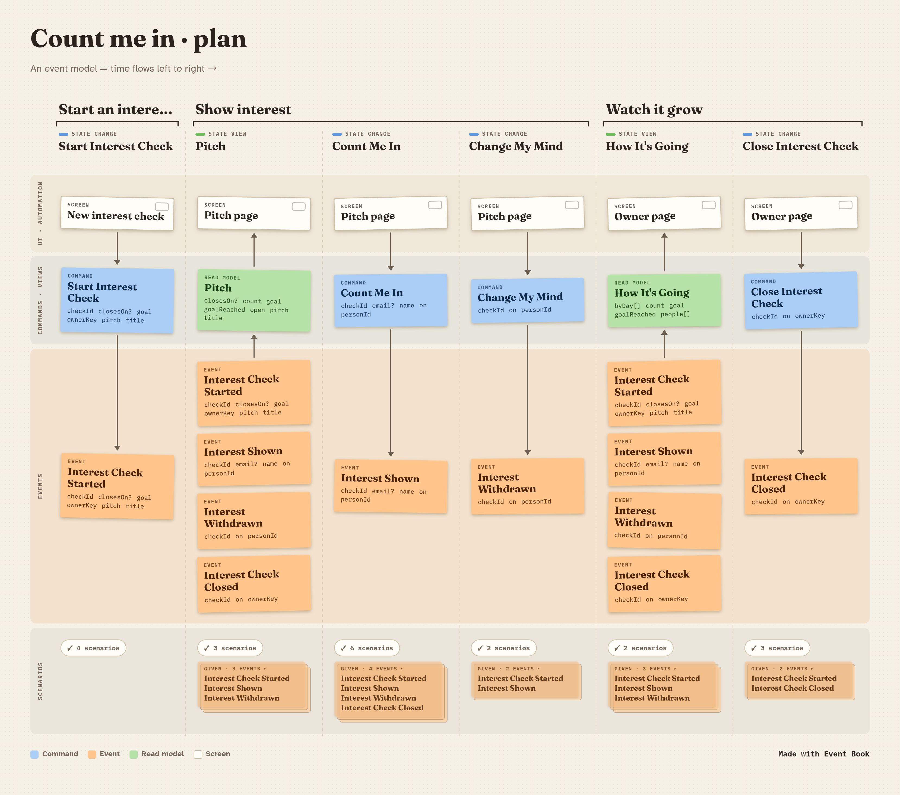

# Count me in

Measure interest in an idea before you do it. Live at **https://countmein.itsybit.se**. Share a pitch with a goal ("10 people would make this worth doing"), people tap **Count me in**, and you watch the count and how fast it grows.

## From model to production

This repo is built in the open, one step per commit, so you can follow how an itsybit app gets from an event model to production:

1. **The model.** Planned and refined in Event Book: [Count me in · plan](https://eventpad.itsybit.se/?book=m_mw2g5ovjfwjvy). The agreed plan is in `docs/model/`.
2. **The specs, red.** Every refined slice becomes Given/When/Then tests before any code exists.
3. **One slice at a time, green.** Each commit makes one slice's scenarios pass.
4. **Production.** The deploy runs the tests and publishes the build book next to the plan.

The build, step by step with shots: [docs/process](docs/process/README.md).

## Shipping: API before web

The pages must never call an endpoint the host doesn't have yet.

- **Web-only change**: merge to main; `Deploy web` uploads the pages.
- **API change**: merge to main (the pages hold back), then tag a release, e.g. `git tag v0.6.0 && git push origin v0.6.0`. `Publish module` ships it, the shared host redeploys, and `Deploy web` waits until `GET /api/countmein/version` says `0.6.0` before it uploads the pages.
