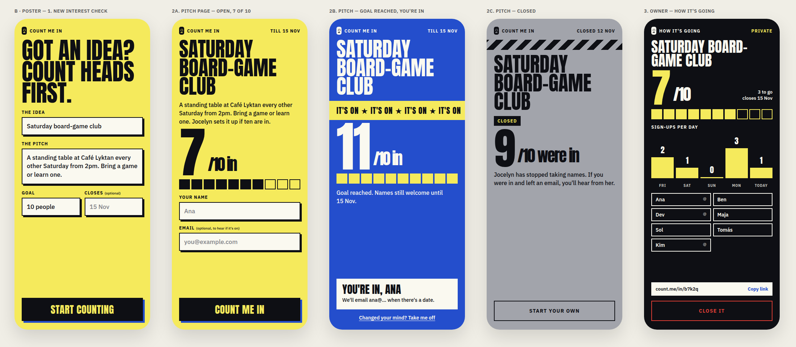

# Design: B · Poster

Picked from three Claude Design directions (Noticeboard, Poster, Quiet) because it looks the most different from everything else.

- **Type:** Anton (headlines, numbers, buttons), IBM Plex Sans (text, labels).
- **Colour:** acid yellow page, ink black, cream fields; each state recolours the whole screen: cobalt with an "IT'S ON ★" banner when the goal is reached, grey with hazard stripes when closed, black for the owner page.
- **Shapes:** hard 2.5px borders, offset shadows, a 10-box meter under a huge "7/10".

Screens: new interest check · pitch (open / goal reached / closed) · owner's How it's going.
Source: Claude Design project "Count me in — 3 directions", file *B Poster.dc.html*.

