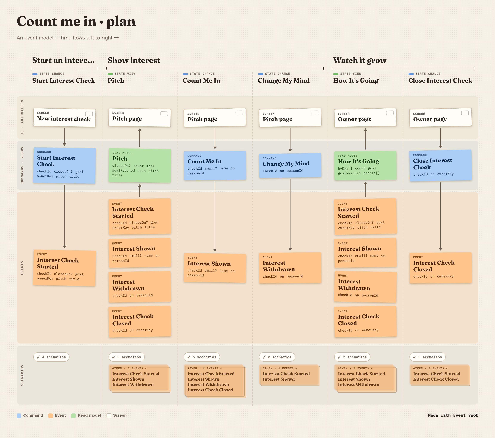
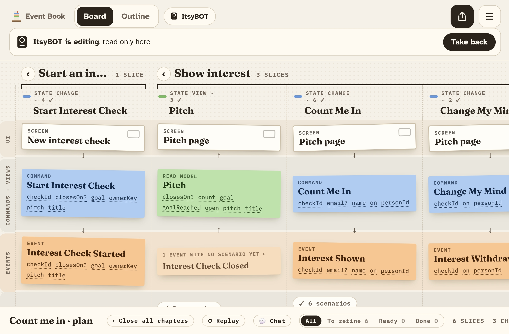
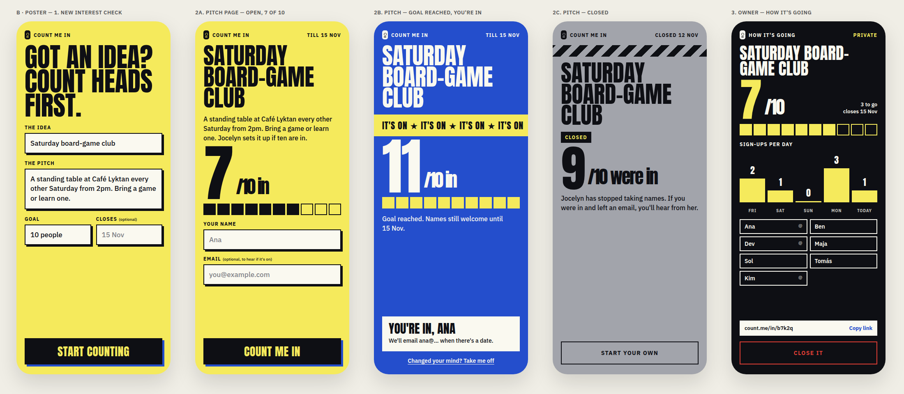
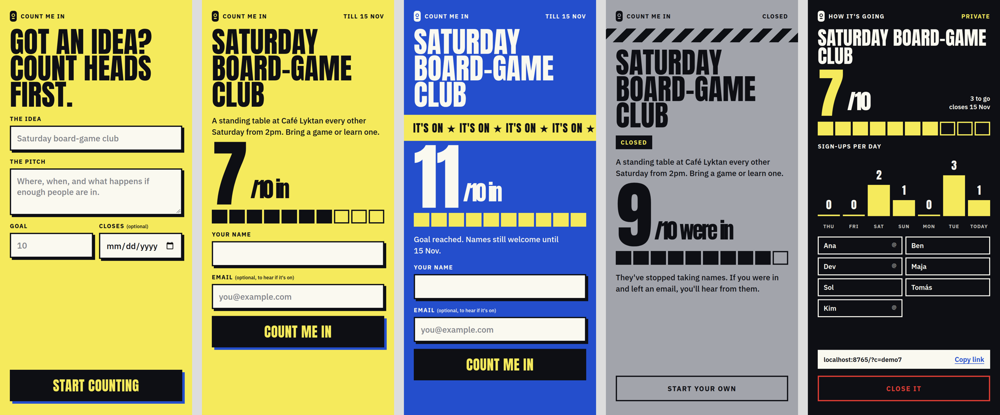
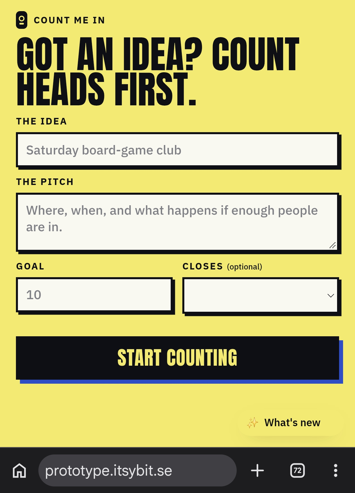

# How Count me in was built

Shots and output from each step, in order, matching the commits.

## 1. The model, refined in Event Book

Six slices in three chapters, each with Given/When/Then scenarios, happy path first. Every slice is ticked Refined before anything gets built.



Commit: *Model: Count me in MVP, refined in Event Book*

## 2. ItsyBOT takes the plan

While the builder (ItsyBOT) works on the plan, it's checked out to it, so the board is read-only on the phone, with a *Take back* button.



## 3. Specs from the model, all red

Event Book writes one spec per refined slice, and a stub beside each that throws `NotBuiltYet`.

```
$ npm test                  # pending: CI stays green while nothing is built
ℹ tests 19
ℹ pass 0
ℹ fail 0
ℹ todo 19

$ npm run test:red          # GWT_RUN_PENDING=1: the same specs, failing
ℹ tests 19
ℹ pass 0
ℹ fail 19
  NotBuiltYet: not built yet
```

Commit: *Specs: Given/When/Then from the model, all red*

## 4. One slice at a time

| Commit | Slice | Green |
|---|---|---|
| Build S1 Start Interest Check | S1 | 4 of 19 |
| Build S2 Pitch | S2 | 7 of 19 |
| Build S3 Count Me In | S3 | 13 of 19 |
| Build S4 Change My Mind | S4 | 15 of 19 |
| Build S5 How It's Going | S5 | 16 of 19 |
| Build S6 Close Interest Check | S6 | 19 of 19 |

```
$ npm test
ℹ tests 19
ℹ pass 19
ℹ fail 0
```

## 5. The look

Three directions from Claude Design, made from the refined model. Picked **B · Poster** ([design/](../../design/README.md)).



## 6. The screens

The slices from step 4 drive the page: every button runs its slice first (the same code the specs test), then asks the server. Shot against a local stand-in for the API, then clicked through end to end (start, count in, take me off, owner sees the name, close, visitor sees Closed, an owner link without its key falls back to the public page).



## 7. Tests by feature

One folder per chapter of the model, each slice's spec next to its slice:

```
tests/gwt/
  start-an-interest-check/  start-interest-check.{test,slice}.mjs
  show-interest/            pitch · count-me-in · change-my-mind
  watch-it-grow/            how-it-s-going · close-interest-check
```

## 8. Live, and fixed on a real phone

Live at [countmein.itsybit.se](https://countmein.itsybit.se) (it started at prototype.itsybit.se, which now forwards old links there): the web page from `main`, the CountMeIn module on the shared host. The first test on a short phone showed the headline pushing *Start counting* below the fold and the What's new pill covering a field; type now scales with the screen's height too, and the page keeps room for the pill.


